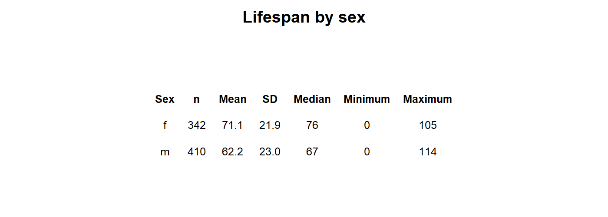

```{=latex}
\onecolumn
\begingroup
\thispagestyle{empty}
\sffamily

% Publication line and journal masthead
\noindent
\begin{minipage}[t]{0.66\linewidth}
  \scriptsize
  Levine. \textit{Survivorship Curves of Sunset Hill Cemetery}
  \hfill (2026) 1:1\\
  Valdosta State University, Ecology and Evolution
\end{minipage}
\hfill
\begin{minipage}[t]{0.30\linewidth}
  \raggedleft
  \large Cemetery Demography\\[-2pt]
  \large BIOL 3250
\end{minipage}

\vspace{0.28in}

% Article-type band
\noindent
\colorbox{reportred}{%
  \parbox{\dimexpr\linewidth-2\fboxsep\relax}{%
    \color{white}
    \textbf{RESEARCH ARTICLE}\hfill
    \textbf{CLASS PROJECT}
  }%
}

\vspace{0.18in}

% Title and author line
\noindent
{\fontsize{23}{27}\selectfont
\textbf{Lifespan is Effected by Sex}\par}

\vspace{0.12in}

\noindent
{\small
Violet Levine \textsuperscript{1,*}
}

\vspace{0.08in}

% Structured abstract
\setlength{\fboxsep}{6pt}
\noindent
\fcolorbox{reportred}{white}{%
  \begin{minipage}{\dimexpr\linewidth-2\fboxsep-2\fboxrule\relax}
    \small

    \textbf{Abstract}

    \vspace{3pt}

    \textbf{Purpose:}
    This project describes lifespan patterns in cemetery records and examines variation by sex.

    \vspace{3pt}

    \textbf{Methods:}
    Recorded available birth and death information from gravestones
    and classified selected characteristics using evidence visible on the stones and in burial arrangements. 

    \vspace{3pt}

    \textbf{Results:}
    The study found compelling evidence to point towards females having higher survivorhip, and therefore longer lifespans, than males.

    \vspace{3pt}

    \textbf{Conclusions:}
    This pattern towards higher survivorship in females suggests further research is needed to determine the exact reasons for higher survivorship rates. The reasons for this survivorship pattern are likely complex and require further examination to draw accurate conclusions about what this can mean for the global population's life expectancy. It is only in this cemetery that a pattern for life expectancy has been established. 

    \vspace{3pt}

    \textbf{Keywords:}
    cemetery records; lifespan; survivorship; marital status; historical demography
  \end{minipage}%
}

% Bottom-page author and institutional details
\vfill

\noindent\rule{0.56\linewidth}{0.4pt}

\vspace{3pt}

\noindent
{\scriptsize
\textsuperscript{*}Correspondence: vmlevine@valdosta.edu\\
\textsuperscript{1}Department of Biology, Valdosta State University,
Valdosta, Georgia, USA\\
Ecology and Evolution, BIOL 3250, Section C
}

\vspace{0.10in}

\noindent
\begin{minipage}[c]{0.20\linewidth}
  \includegraphics[width=0.72in]{Valdosta_State_University_seal.png}
\end{minipage}
\endgroup
\twocolumn
```

# Background

Cemetery records provide individual birth and death dates that can be used to describe lifespan among people represented in a burial ground. These records are a non-random sample: cemetery access, preservation of markers, migration, family burial practices, and the choice of graves to record may all affect which people appear in the dataset. The analyses below therefore describe the collected sample and should not be treated as direct estimates of lifespan for an entire town or historical population.

# Hypotheses

I hypothesized that women would have a greater lifespan than men in this sample because men are typically drafted in wars and also display more reckless behavior in their youth.

# Methods

## Field Site and Sampling

- **Location:** We went to Sunset Hill Cemetery in Valdosta, Georgia, next to Valdosta State University’s campus on Thursday, October 8th. We stayed near the entrance of the cemetery and split up by the gate.
- **Date & Time of Day:** On October 8th, we started our investigation in the cemetery around 2:30 pm, and we finished around 4:30 pm. The weather was clear and suitable for our fieldwork.
- **Part of Cemetery Sampled:** I sampled the southeast section of the cemetery in rows.
- **Grave Selection:** Sampling was based on how legible the markings of each grave were. Besides that, grave selection was random and done by completing rows.
- **Process of Data Collection for Nearby Graves & Family Plots:** Neighboring graves, such as family plots, were recorded. Few family plots were found in my section and mainly comprised of married couples. So, there was no overabundance of the same families in my sample.

## Recorded information and variable definitions

- **Information Collected from Each Marker:** Data collected from each marker included name, birth date, date death, sex, marriage status, and veteran status. 
- **Calculation of Lifespan:** Lifespan was calculated by subtracting birth year from the death year. Partial dates were not recorded.
- **Determination of Marital Status:** Marital Status was determined through joint graves with the same last names or writing containing "Husband and Wife."
- **Determination of Military Service:** Evidence of military service was only recorded if ranks were etched on the grave.
- **Determination of Sex or Gender:** Sex was determined through explicit titles like wife, mother, sister, etc. being used. If no title was found, then an inference was made based on naming conventions.
- **Handling of Missing, Illegible, or Ambiguous Records:** Any name or date that was ambiguous in our records was excluded.

## Dataset and analysis

- **Total Records Collected:** 32 records were collected by me.
- **Amount of Records Included in the Final Analysis:** 30 records were included in the final analysis. 2 were excluded due to no death dates or a missing family name.
- **Aggregation of Records with Class Dataset:** Yes, my records were aggregated to the class dataset. Our professor, Dr. Hendrickson, sorted and got rid of any duplicates found in this dataset. 
- **Summaries or Plots Produced:** Our sample shows relationships between survivorship and birth period, sex, martial status, and military status. A positive relationship exists between each category and shows a correlation in both factors. 
- **Limitations of the Sample:** Limitations of the sample include damage to graves reducing sample size, incomplete dates, uneven documentation, possible inaccuracies in sex due to naming conventions, and not being able to document military service on graves that don't mention service.  

# Results
{#fig-summary width=90% fig-pos="t" fig-env="figure*"}

*The summary table in @fig-sex shows substantial differences in recorded lifespan by sex in this sample. Males had a mean lifespan of 62.2 years (SD = 23; n = 410), compared with 71.1 years (SD = 23.0; n = 342) for females. The relatively large subgroup sizes supports a reasonable pattern for further study.*

{#fig-sex width=70% fig-pos="t" fig-env="figure*"}

*The sex-specific survivorship curves in @fig-sex show a similar pattern: the plotted means are 62.2 years for males and 71.1 years for females. The female curve remains higher through much of the earlier and middle lifespan, while the male curve reaches the 50% survival point later. The curves are close and change relative position, so the figure suggests that the sex difference depends on which part of the lifespan distribution is considered. The median markers indicate where each group’s observed curve reaches 50% surviving; they are distinct from the mean values shown in the legend.*

**Summary of Observed Results:** The pattern for sex as a factor for lifespans is clear. From the recorded instances, females typically have a higher liklyhood to survive at each stage of life than males. Even with a slanted sample size (m = 410, f = 342, t = 752), males still display a higher liklyhood of dying at different stages of life than females. The mean for 50% survivorship is at 71.1 for females and 62.2 for males, so, on average, more women survive longer than men. The only time either sex has a similar liklyhood to die is around the newborn/infant stage. 

# Discussion

**Sex and Lifespan:** Research on sex differences in longevity points to a combination of biological, behavioral, and social influences rather than a single explanation. So, the reason for men to be more likely to die than women is due to a plethora of factors that are hard to narrow down in research. In this cemetery sample, the observed female and male curves stay close but are consistently higher in women and support the prediction that women have a higher lifespan than men. The result should be interpreted in the context of this cemetery’s birth cohorts and sampling process; it is not by itself an estimate of a general sex difference in lifespan.

**Limitations and next steps:** This study has a relatively good sample size of 752 total graves marked. The limitations of this study do include issues with recording data and potential bias of the cemetery location and demographics of those buried there. There is missing and incomplete data that was taken out of the study due to not providing the needed information. This was rare but must still be noted. The demographics of the cemetery must also be taken into account, with the time periods of those buried taking place mainly before and after the 1930s and the cemetery located in South Georgia. There are also issues with family clustering in the cemetery.

Despite the previous limitations, the sample size and results of the study do provide a compelling argument for further research. There seem to be many reasons for sex-based survivorship that would require further study, but the pattern is there, and more research could be done on this subject.

```{=latex}
\newpage
```